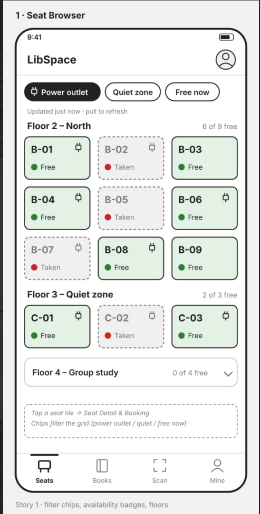
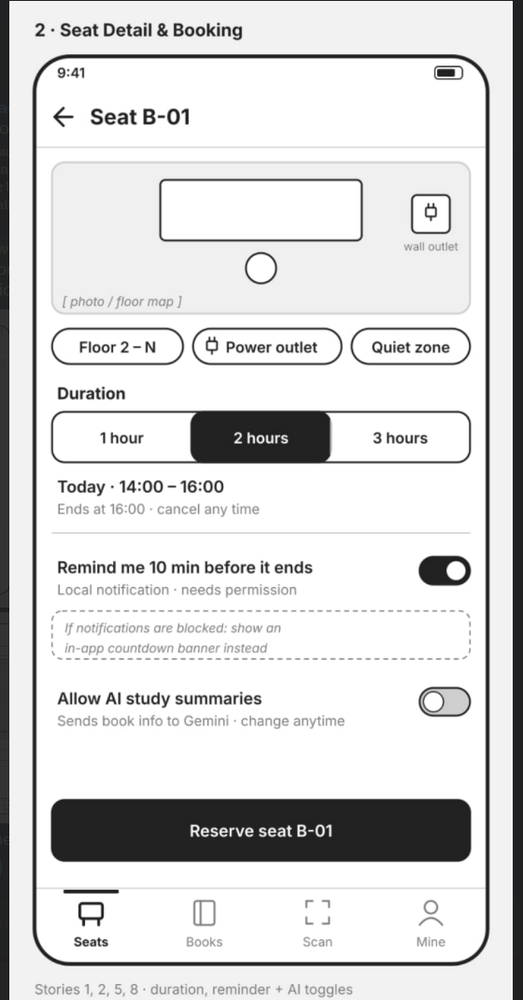
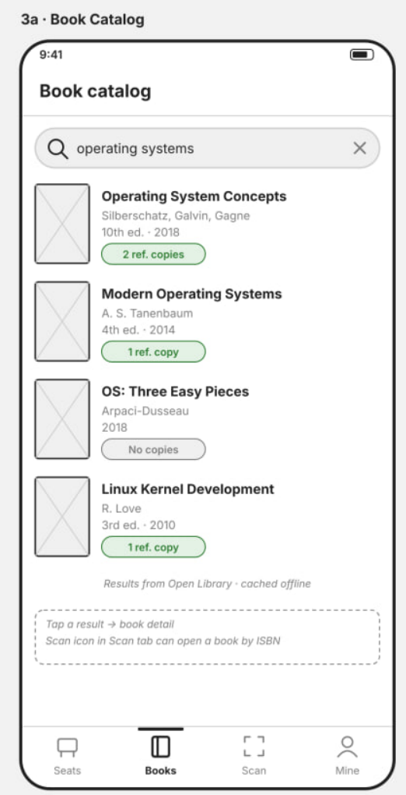
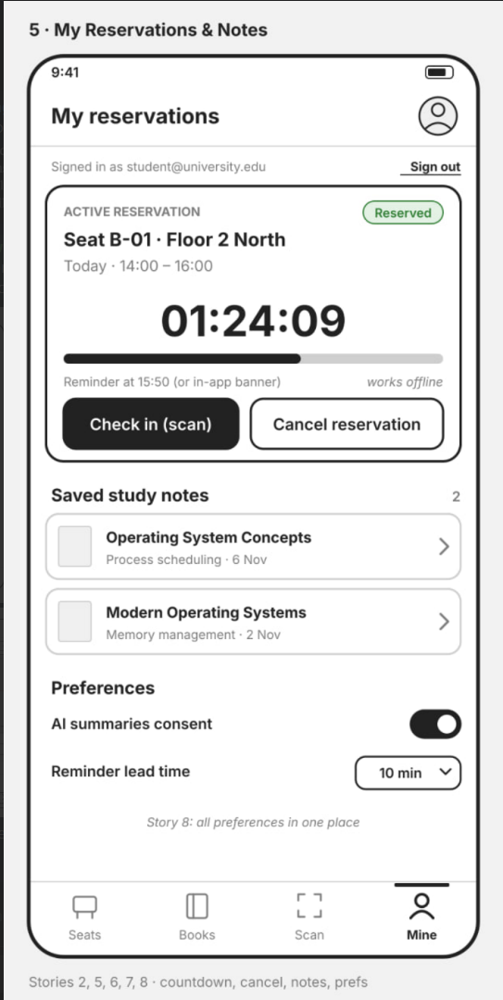

# Project proposal

## 1. Title and one-sentence description
**LibSpace: Campus Library Seat & Book Companion**
An app that helps university students to discover reference books and reserve library study seats with power outlets in real time so that they can secure productive workspaces and plan study sessions without wasted trips.

## 2. Group

| Name | Role |
| :--- | :--- |
| Leawi Taddesse Berisso | Architecture, State Management & AI Integration Lead |
| Rame Mahamat | Backend, Firebase & Local Persistence Lead |
| Nahim Teklu | REST API, Camera Scanner & Notifications Lead |
| Latera Tilahun | UI/UX, Accessibility & Testing Lead |

## 3. The problem
Finding an available study desk at our university library—especially during midterms and final examination weeks—is currently a manual, frustrating process of trial and error. Because there is no digital tracking of study spaces, students must walk through multiple library floors hunting for an open chair. 

When we interviewed third-year student **Abel Tesfaye** and fourth-year student **Eyob Nebiyou**, both emphasized two major recurring problems: 
* An overall shortage of study seats during peak hours.
* The extreme difficulty of finding a seat next to a working wall power socket to keep their laptops charged during long coding or study sessions.

Additionally, while students often download general textbooks online, specialized physical reference materials, local theses, and reserve copies must still be accessed inside the library by leaving a physical student ID card at the circulation desk. 

Today, students have no way of knowing before walking to the library whether a study desk with a power outlet is free, nor can they quickly inspect whether a physical reference book covers their syllabus topic without queuing at the counter. 

A mobile application is the ideal solution because students carry their phones everywhere on campus and need real-time visibility while commuting or walking between lecture halls. A native mobile app also bridges the physical and digital library experience: it uses the device camera to scan physical book ISBN barcodes or desk QR markers, caches active reservation passes offline when campus Wi-Fi drops, and triggers local device notifications before a study block expires.

## 4. Users
* **Laptop-Dependent Commuter Student:** A student who commutes to campus and needs a guaranteed seat near a wall socket for 1 to 3 hours between or after lectures. They use the app 3–5 times per week (and daily during midterm and final exam periods) to filter seats by power availability, reserve a time slot, and get a reminder notification before their session ends.
* **Final-Year / Research Student:** A senior or graduate student looking for physical reference books, local academic materials, or exam preparation guides held for in-library use. They use the app 1–2 times per week to search the book catalog, scan ISBN barcodes on physical books with their camera, and generate AI-assisted topic summaries to decide if a reference book is worth trading their ID for at the desk.
* **Short-Session Exam Crammer:** A student with a 1-hour gap between classes who wants to quickly find any open quiet seat, check in, and release the seat early when leaving so classmates can use it. They use the app 2–3 times per week.

## 5. User stories
1. As a commuter student, I want to browse library study seats by floor area and filter by power outlet availability so that I can find a desk where I can plug in my laptop before walking to the library. (**must**)
2. As a student, I want to reserve an available study seat for a selected duration (1–3 hours) and view my active booking offline so that my workspace is recorded even when campus Wi-Fi disconnects. (**must**)
3. As a student in the library, I want to scan a desk QR code or a physical book's ISBN barcode using my phone camera (or enter the code manually if camera permission is denied) so that I can check into my reserved seat or open a book's catalog record immediately. (**must**)
4. As a student researcher, I want to search the library book catalog via a REST service and view book metadata so that I can identify relevant reference materials for my courses. (**must**)
5. As a student studying for exams, I want to schedule a local notification reminder 10 minutes before my seat reservation expires so that I know when to wrap up or extend my session. (**should**)
6. As a student researcher, I want to request an AI-generated study guide and syllabus relevance summary for a catalog book (after giving explicit consent) and confirm saving it to my offline study notes so that I can plan my reading session efficiently. (**should**)
7. As a library user, I want to cancel my active seat reservation early so that the seat becomes available for other students and my pending expiration notification is automatically cancelled. (**could**)
8. As a privacy-conscious student, I want to manage my AI consent preference and notification lead-time settings in one place so that I stay in control of how the app uses device permissions and external AI services. (**could**)

## 6. Screens

| Screen | Purpose | User stories |
| :--- | :--- | :--- |
| **1. Seat Browser Screen** | Displays a responsive grid/list of library study desks grouped by floor area with live availability badges and filter chips for power outlets and quiet areas. | 1 |
| **2. Seat Detail & Booking Screen** | Shows specific desk attributes, a duration selector (1, 2, or 3 hours), a local reminder toggle, AI/notification preference toggles, and a reservation confirmation button. | 1, 2, 5, 8 |
| **3. Book Catalog & AI Helper Screen** | Searches the REST book catalog, displays book details, and provides a consent-gated AI Study Summary generator with a user confirmation button to save notes. | 4, 6, 8 |
| **4. Camera Scanner Screen** | Uses the device camera (with full permission state handling and manual code fallback) to scan desk QR codes for check-in or ISBN barcodes to open book details. | 3 |
| **5. My Reservations & Notes Screen** | Displays the student's active seat booking (with countdown and cancel action) and saved AI study guides from local persistence and Firestore, plus sign-in/sign-out controls. | 2, 5, 6, 7 |

### Screen Sketches

* **Sketch 1 — Seat Browser Screen:**

  

* **Sketch 2 — Seat Detail & Booking Screen:**

  

* **Sketch 3 — Book Catalog & AI Helper Screen:**

  

* **Sketch 4 — My Reservations & Scanner Screen:**

  

## 7. Data model
All domain models will be immutable Dart classes generated with `freezed` and `json_serializable`:

```text
AppUser: uid, email, displayName, studentId 
Seat: id, code, floorArea, hasPowerOutlet, isQuietZone, isAvailable, currentReservationId 
Reservation: id, userId, seatId, seatCode, startTime, endTime, reminderEnabled, status (reserved | checkedIn | cancelled | expired) 
BookItem: isbn, title, authors, publishYear, coverUrl, subjectTags, availableReferenceCopies 
StudyNote: id, userId, isbn, bookTitle, studyTopicQuery, aiSummaryMarkdown, createdAt 
UserPreferences: hasGrantedAiConsent, reminderLeadMinutes, lastSyncedAt 
```

### Relationships:
* **One AppUser** can have active or past `Reservation` records (`Reservation.userId` -> `AppUser.uid`) and multiple saved `StudyNote` items (`StudyNote.userId` -> `AppUser.uid`).
* **One Seat** links to at most one active `Reservation` at a time (`Seat.currentReservationId` -> `Reservation.id`).
* **One BookItem** (by isbn) can be referenced by multiple `StudyNote` entries.

## 8. Data sources
Every data source is accessed strictly through an abstract repository interface injected via Riverpod providers:

* **Local Persistence (`shared_preferences` behind `LocalCacheRepository`):**
  * Stores the serialized active `Reservation` list and saved `StudyNote` items so Screen 5 renders immediately on cold start and works without network connectivity.
  * Persists `UserPreferences` (`hasGrantedAiConsent`, `reminderLeadMinutes`, and scheduled notification IDs) across app restarts.
* **REST Web Service (Open Library REST API / local JSON test server behind `BookCatalogRepository`):**
  * **Production flavor:** Queries the Open Library REST API (`https://openlibrary.org/search.json` and ISBN endpoints) for book titles, authors, publication years, subjects, and cover images.
  * **Development flavor:** Connects to a local mock REST server serving deterministic book catalog JSON fixtures for offline development and automated testing.
* **Firebase (`FirebaseAuth` and `Cloud Firestore` behind `AuthRepository` and `SeatReservationRepository`):**
  * **Firebase Auth:** Handles student email/password sign-in and session state.
  * **Cloud Firestore:** Stores the seats collection (floor area, power outlet flags, occupancy status) and the reservations collection. The development flavor connects to the local Firebase Auth and Firestore Emulators; the production flavor connects to the live Firebase project protected by tested Firestore security rules.

## 9. Device feature and AI feature

### Device Feature 1 — Camera Barcode/QR Scanner (`BarcodeScannerService`)
* **User Story:** Story 3 (scanning a desk QR code to check in or a book ISBN barcode to look up details).
* **Permissions:** Requests `android.permission.CAMERA`.
* **Permission Outcomes Handled:**
  * **Granted:** Displays the live camera viewfinder (`mobile_scanner`).
  * **Denied (can request again):** Displays an informative rationale banner with a "Grant Camera Access" retry button and a manual code text field.
  * **Permanently Denied / Restricted:** Displays instructions with an "Open App Settings" button alongside the manual text entry fallback so the user is never blocked.
  * **Unavailable / Emulator Error:** Displays a graceful hardware error state and defaults to manual code input.

### Device Feature 2 — Local Notifications (`NotificationService`)
* **User Story:** Stories 5 and 7 (scheduling and cancelling seat expiration alerts).
* **Permissions:** Requests `android.permission.POST_NOTIFICATIONS` (Android 13+). Handles granted, denied, and permanently denied outcomes with an in-app countdown banner fallback when notifications are disabled.

### AI Feature — AI Study Guide & Relevance Assistant (`AiStudyService`)
* **User Story:** Story 6 (generating a study summary and key concepts for a selected reference book).
* **Consent & Disclosure:** Before making any request, the user must review and accept a disclosure modal explaining that the selected book's title, author, subject tags, and the student's entered course topic are sent to Google's Gemini API (`gemini-2.5-flash`), and that AI responses may contain inaccuracies.
* **Confirmation & Failure Handling:** The generated output is clearly labeled as AI-generated and displayed in a preview card; it is never saved or acted upon unless the user explicitly taps "Confirm & Save to Notes". The service interface explicitly handles and tests slow responses (timeout message with retry), refused/blocked prompts (safety message), and malformed outputs.

## 10. Risks

| Risk | Likelihood | Plan |
| :--- | :--- | :--- |
| Open Library REST API experiences downtime or rate-limiting during testing or grading | Medium | Keep all REST calls behind `BookCatalogRepository`, use a local mock REST server in the development flavour, and cache recent search results locally. |
| Beginners in the group struggle with Riverpod + Freezed code generation conflicts | Medium | Set up a shared starter template in Week 4 with one vertical slice working, run `build_runner` checks in CI, and hold weekly pair-programming sessions. |
| Android camera or notification permissions behave differently on emulators vs. physical phones | Medium | Wrap both features behind abstract service interfaces with fake implementations for unit/widget tests, and provide a manual code input / in-app banner fallback. |
| AI API quota limits or leaked API keys in Git history | Low | Inject the Gemini API key exclusively via `--dart-define-from-file` (ignored in `.gitignore`), enforce a secret check in PR reviews, and mock `AiStudyService` in CI tests. |
| Team member illness or competing midterm exam schedules around Weeks 6–10 | Medium | Split tasks into small independent PRs early each milestone week so another member can review or take over unfinished tasks at least 48 hours before deadlines. |

## 11. Milestone plan

### Milestone 1 (Week 6 — Screens, Navigation, In-Memory State)
* Complete UI for all 5 screens with `go_router` navigation and responsive layouts tested at 360 px and 900 px widths.
* Define all freezed domain models (`AppUser`, `Seat`, `Reservation`, `BookItem`, `StudyNote`) and Riverpod state providers backed by in-memory fake repositories.
* Stories 1, 2, 4, and 7 navigable end-to-end using in-memory state.

### Milestone 2 (Week 10 — Data, Backend, Automated Tests)
* Connect Firebase Auth and Cloud Firestore (`SeatReservationRepository` and `AuthRepository`) with Firestore emulator support and security rule tests.
* Connect the Open Library REST API (`BookCatalogRepository`) and local persistence (`LocalCacheRepository` with `shared_preferences`) surviving app restarts.
* Complete unit tests for every repository (including failure paths) and widget tests for all data-loading screens (loading, data, empty, and error states) running in GitHub Actions.
* Stories 1, 2, 4, and 7 working with real data and persistence.

### Final Submission (Week 14 — Device, AI, Flavours, Polish & Release)
* Complete Camera QR/ISBN scanner (Story 3), Local Notifications (Story 5), and Gemini AI Study Assistant with consent and confirmation flows (Stories 6 and 8), including all permission and failure-state tests.
* Add end-to-end integration tests for every "must" user story and reach at least 60% line coverage in CI.
* Configure development and production flavours with separate application IDs, build the signed production release `.apk`/`.aab`, and finalize `README.md`, `DECISIONS.md`, `AI_USAGE.md`, `PRIVACY.md`, and `USER_TEST.md`.

## 12. AI-use plan
Our group intends to use AI assistants (such as Gemini and GitHub Copilot) strictly as learning aids and productivity tools while adhering to the course academic integrity policy:

* **Learning & Conceptual Understanding:** Explaining Flutter, Riverpod AsyncNotifier patterns, `go_router` configuration, and Firebase emulator setup.
* **Boilerplate & Test Scaffolding:** Assisting with repetitive freezed model boilerplate, JSON serialization setup, and scaffolding initial unit/widget test harnesses that we then customize and verify manually.
* **Debugging & Code Review:** Diagnosing `flutter analyze --fatal-infos` warnings, layout overflow errors at 360 px / 900 px, and GitHub Actions CI failures.
* **Verification & Documentation Rule:** Every AI-assisted file will be logged as we work in `AI_USAGE.md` (recording the tool used, our manual modifications, and at least one verified error or limitation we caught and fixed). No member will commit code they cannot explain line-by-line during individual oral checks.
